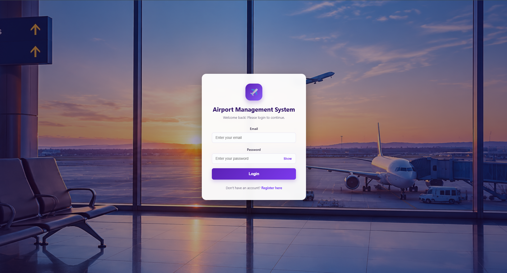
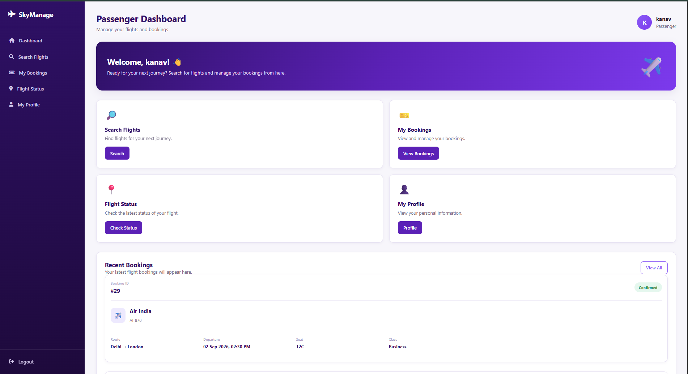
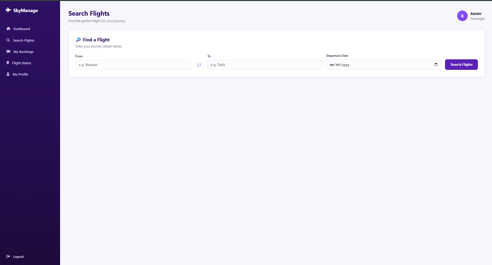
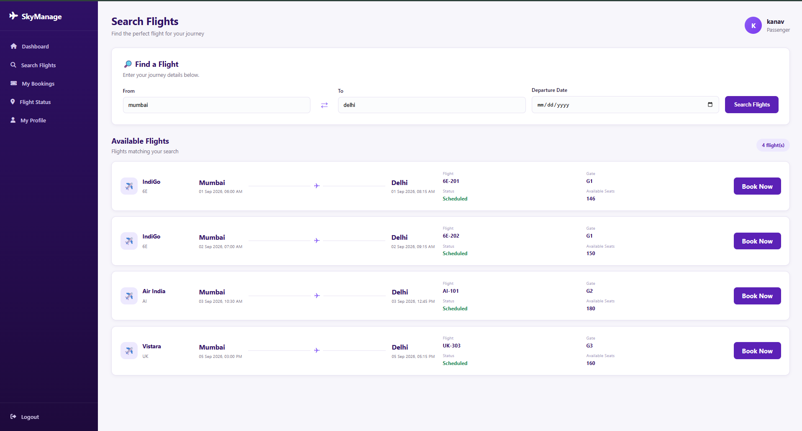
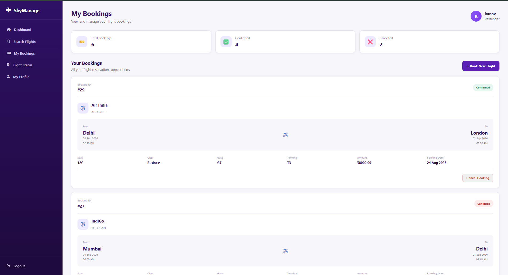
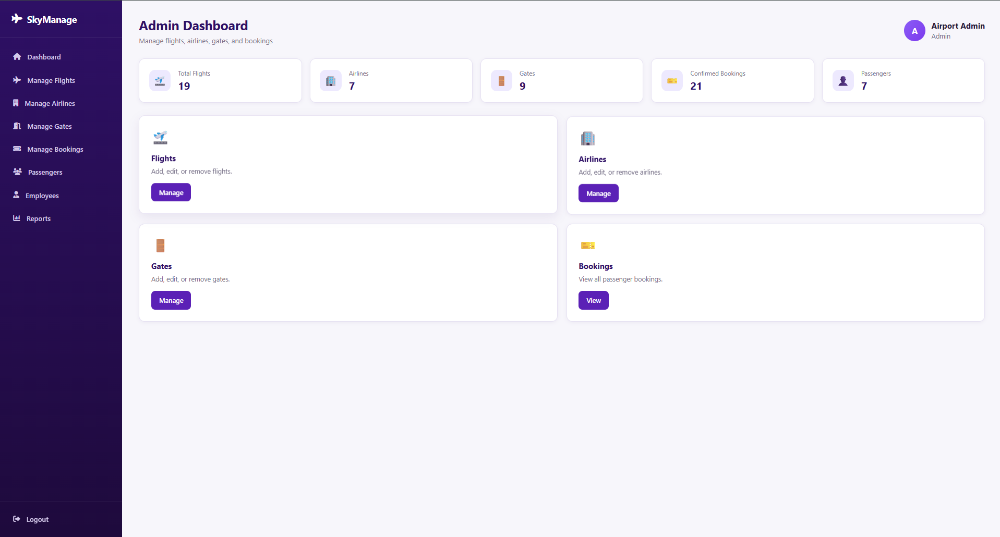
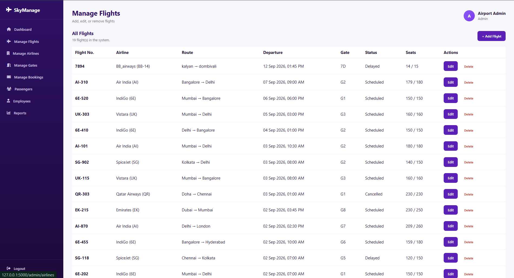
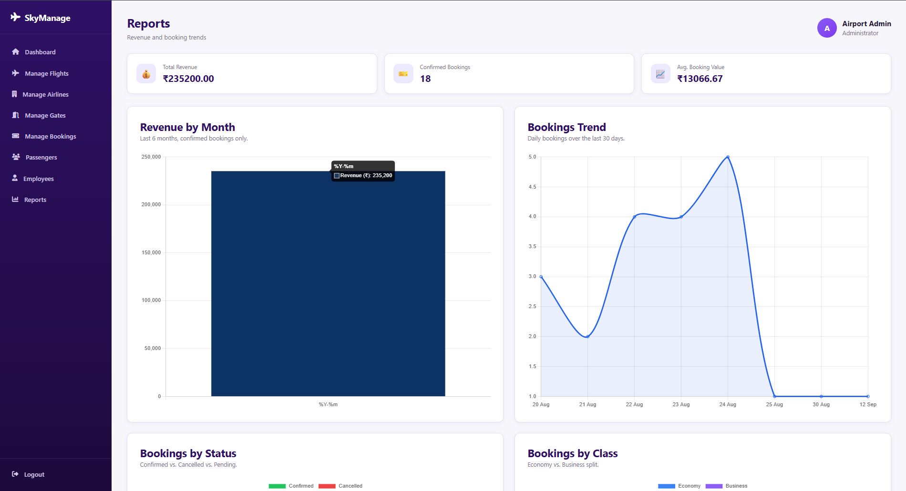

<div align="center">

# ✈️ SkyManage 2.0

### Airport Management & Flight Booking System

**A Full-Stack Web Application for Smart Airport Operations**


[Features](#-key-features) •
[Tech Stack](#-technology-stack) •
[Installation](#-installation--setup) •
[Developer](#-developer)

</div>

---

## 📖 About the Project

**SkyManage 2.0** is a full-stack Airport Management System developed using Python Flask and MySQL.

The system simplifies airport operations by providing a centralized platform for flight booking, passenger management, airline management, gate assignments, employee management, and administrative reporting.

The application provides two role-based portals:

- **Passenger Portal:** Search flights, book tickets, manage bookings, and check flight status.
- **Admin Portal:** Manage flights, airlines, passengers, employees, gates, and view reports.

This project demonstrates practical implementation of full-stack web development, database management, authentication, and CRUD operations.

---

## 🚀 Key Features

### 👤 Passenger Portal

- 🔐 Secure Registration and Login
- 🔎 Search Flights by Source, Destination, and Date
- 🎫 Flight Ticket Booking
- 💺 Travel Class Selection
- 📋 View Booking History
- ❌ Cancel Bookings
- ✈️ Check Flight Status
- 👤 Update Passenger Profile
- 📊 Personalized Dashboard

### 🛠️ Admin Portal

- 📊 Interactive Admin Dashboard
- ✈️ Add, Update, and Delete Flights
- 🏢 Manage Airlines
- 🚪 Manage Airport Gates
- 👥 Manage Employees
- 🧳 View Passenger Information
- 🎟️ Manage Flight Bookings
- 📈 View Reports and Analytics
- 💰 Monitor Booking Revenue

---

## 🖼️ Project Screenshots

### Login Page



### Passenger Dashboard



### Flight Search



### Flight Booking



### My Bookings



### Admin Dashboard



### Admin Flight Management



### Admin Reports



---

## 💻 Technology Stack

| Component | Technology |
|-----------|------------|
| Frontend | HTML5, CSS3, JavaScript |
| Backend | Python, Flask |
| Database | MySQL |
| Template Engine | Jinja2 |
| Authentication | Flask Sessions, Werkzeug |
| Database Connector | mysql-connector-python |
| Data Visualization | Chart.js |
| Development Environment | Visual Studio Code |
| Version Control | Git & GitHub |

---

## 📁 Project Structure

```text
SkyManage2.0/
│
├── app.py
├── requirements.txt
├── .env.example
├── .gitignore
├── README.md
│
├── database/
│   └── airport_management.sql
│
├── static/
│   ├── css/
│   │   └── style.css
│   ├── js/
│   │   └── script.js
│   └── images/
│
├── templates/
│   ├── login.html
│   ├── register.html
│   ├── passenger_dashboard.html
│   ├── search_flights.html
│   ├── book_flight.html
│   ├── my_bookings.html
│   ├── flight_status.html
│   ├── profile.html
│   │
│   ├── admin_dashboard.html
│   ├── admin_flights.html
│   ├── admin_airlines.html
│   ├── admin_gates.html
│   ├── admin_employees.html
│   ├── admin_passengers.html
│   ├── admin_bookings.html
│   └── admin_reports.html
│
└── docs/
    └── screenshots/
```

---

## 🗄️ Database Design

SkyManage 2.0 uses a relational MySQL database to store and manage airport information.

### Main Database Tables

| Table | Description |
|-------|-------------|
| users | Stores authentication and role information |
| passengers | Stores passenger details |
| airlines | Stores airline information |
| flights | Stores flight schedules and routes |
| bookings | Stores passenger reservations |
| gates | Stores airport gate information |
| employees | Stores airport employee records |

### Database Relationships

- Each passenger is associated with a user account.
- Each flight belongs to an airline.
- Each flight can be assigned to an airport gate.
- Each booking connects a passenger with a flight.

---

## ⚙️ Installation & Setup

Follow these steps to run SkyManage 2.0 locally.

### Prerequisites

Make sure the following are installed:

- Python
- MySQL Server
- MySQL Workbench (Optional)
- Git
- Visual Studio Code (Recommended)

### Step 1: Clone Repository

```bash
git clone https://github.com/bhushancodes07/SkyManage2.0.git
```

Navigate to the project folder:

```bash
cd SkyManage2.0
```

### Step 2: Create Virtual Environment

```bash
python -m venv venv
```

Activate the virtual environment on Windows:

```powershell
.\venv\Scripts\Activate.ps1
```

### Step 3: Install Dependencies

```bash
pip install -r requirements.txt
```

### Step 4: Configure MySQL Database

Open MySQL Workbench and create the database:

```sql
CREATE DATABASE IF NOT EXISTS airport_management;
```

Import the project's SQL schema to create the required tables.

### Step 5: Configure Environment Variables

Create a `.env` file in the project root.

```env
DB_HOST=localhost
DB_USER=root
DB_PASSWORD=your_mysql_password
DB_NAME=airport_management
SECRET_KEY=your_secret_key
```

Generate a secure secret key using:

```bash
python -c "import secrets; print(secrets.token_hex(32))"
```

**Important:** Never upload the `.env` file or real passwords to GitHub.

### Step 6: Run the Application

```bash
python app.py
```

Open your browser and visit:

http://127.0.0.1:5000

---

## 🔐 Authentication & Security

SkyManage 2.0 implements role-based authentication.

### Passenger Authentication

- Account Registration
- Login and Logout
- Password Hashing
- Session Management

### Administrator Authentication

- Role-Based Access Control
- Protected Admin Routes
- Administrative Dashboard Access

### Security Considerations

- Passwords are hashed using Werkzeug.
- Database credentials are configured through environment variables.
- SQL queries should use parameterized statements.
- Production deployments should implement CSRF protection.
- Flask debug mode should be disabled in production.
- Default administrator credentials must be replaced before deployment.

---

## 🔄 System Workflow

### Passenger Workflow

1. Register or log in.
2. Search available flights.
3. Select a flight.
4. Choose a travel class.
5. Confirm the booking.
6. View or cancel reservations.
7. Check flight status.

### Administrator Workflow

1. Log in as administrator.
2. Access the admin dashboard.
3. Manage flights and airlines.
4. Assign airport gates.
5. Manage employees and bookings.
6. Review passengers.
7. Analyze reports.

---

## 🎯 Project Objectives

- Digitize airport management operations.
- Simplify flight search and reservation processes.
- Maintain organized passenger and flight records.
- Implement role-based user authentication.
- Demonstrate database relationships and CRUD operations.
- Provide administrative insights through reports.

---

## 🔮 Future Enhancements

- [ ] Email Booking Confirmations
- [ ] Online Payment Gateway Integration
- [ ] Automated Ticket Generation
- [ ] QR Code-Based Boarding Passes
- [ ] Advanced Flight Filtering
- [ ] Real-Time Airline API Integration
- [ ] Mobile Responsive Improvements
- [ ] Automated Testing and CI/CD
- [ ] Secure Production Deployment

---

## 🤝 Contributing

Contributions and suggestions are welcome!

1. Fork this repository.
2. Create a feature branch.
3. Make your changes.
4. Commit your changes.
5. Push your branch.
6. Open a Pull Request.

---

## 👨‍💻 Developer

### Bhushan Baviskar

**Computer Engineering Student | Full-Stack Development Enthusiast**

Passionate about building practical software solutions and exploring modern web technologies.

**GitHub:** [@bhushancodes07](https://github.com/bhushancodes07)

**Project Repository:** [SkyManage 2.0](https://github.com/bhushancodes07/SkyManage2.0)

---

<div align="center">

### ⭐ Support the Project

If you find this project useful, consider giving it a star!

**Made with ❤️ using Python, Flask & MySQL**

© 2026 SkyManage 2.0

</div>
