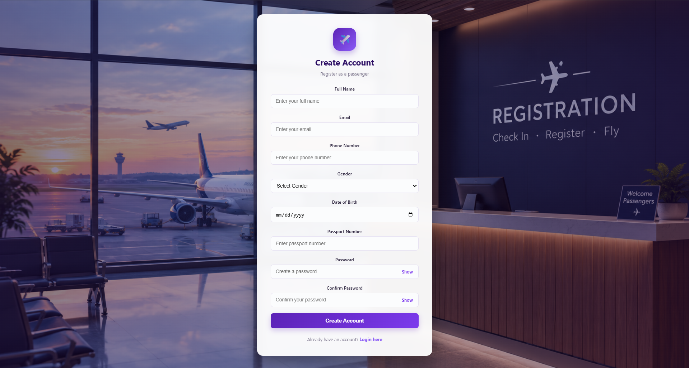

<div align="center">


# ✈️ SkyManage — Airport Management System

**A full-stack flight booking platform with role-based passenger and admin portals.**
</div>
## Badges


## Table of Contents

- [Overview](#overview)
- [Features](#features)
- [Screenshots / Demo](#screenshots--demo)
- [Tech Stack](#tech-stack)
- [Project Structure](#project-structure)
- [Database Schema](#database-schema)
- [Getting Started](#getting-started)
- [Creating an Admin Account](#creating-an-admin-account)
- [Security Notes](#security-notes)
- [Roadmap](#roadmap)
- [Contributing](#contributing)
- [License](#license)
- [Author](#author)

## Overview

SkyManage is a full-stack flight booking platform built with Flask and MySQL. It provides two distinct portals — one for passengers to search, book, and manage flights, and one for administrators to manage flights, airlines, gates, bookings, passengers, and employees through a live analytics dashboard. This project was built as a college project to explore full-stack web development with role-based access control.

## Features

### Passenger Portal

| Icon | Feature | Description |
|------|---------|--------------|
| 🔐 | Authentication | Register and log in as a passenger |
| 🔍 | Flight Search | Search flights by source, destination, and date |
| 🎟️ | Flight Booking | Book seats with live fare updates by travel class |
| 📋 | Manage Bookings | View and cancel existing bookings |
| 🛫 | Flight Status | Look up real-time status of any flight |
| 👤 | Profile Management | Edit personal profile information |
| 📊 | Dashboard | View a summary of recent bookings at a glance |

### Admin Portal

| Icon | Feature | Description |
|------|---------|--------------|
| 📈 | Dashboard | Summary stats across flights, bookings, and passengers |
| ✈️ | Flights CRUD | Create, read, update, and delete flight records |
| 🏢 | Airlines CRUD | Manage airline records |
| 🚪 | Gates CRUD | Manage gate assignments |
| 📦 | Booking Management | Search bookings and filter by status |
| 🧾 | Passenger Directory | Read-only, searchable list of all passengers |
| 👥 | Employees CRUD | Full create/read/update/delete for employee records |
| 📉 | Reports | Live Chart.js graphs for revenue, trends, and routes |

## Screenshots / Demo

Below are placeholders for key screens in the app. 


*Login page with role-based authentication*



*sign in page for passengers*


*Passenger dashboard showing recent bookings*


*Flight search results filtered by source, destination, and date*


*Booking page with live fare updates by class*


*Passenger's view/cancel bookings page*


*Admin dashboard with summary statistics*


*Admin flight management with full CRUD*


*Live analytics dashboard with Chart.js graphs*


## Tech Stack

**Backend**
- [Python](https://www.python.org/)
- [Flask](https://flask.palletsprojects.com/)
- [mysql-connector-python](https://dev.mysql.com/doc/connector-python/en/)
- [Werkzeug](https://werkzeug.palletsprojects.com/) (password hashing)
- [Jinja2](https://jinja.palletsprojects.com/) (templating)

**Frontend**
- HTML5 / CSS3 / Vanilla JavaScript
- [Font Awesome](https://fontawesome.com/) (icons)
- [Chart.js](https://www.chartjs.org/) (analytics charts)

**Database**
- [MySQL](https://www.mysql.com/)

## Project Structure

```text
SkyManage/
│
├── database/
│   └── airport_management.sql       # MySQL database schema
│
├── static/
│   ├── css/
│   │   └── style.css                # Main stylesheet
│   │
│   ├── images/
│   │   └── airport-login.png        # Login page image
│   │
│   └── js/
│       └── script.js                # Client-side JavaScript
│
├── templates/
│   ├── login.html                   # Passenger/Admin login
│   ├── register.html                # Passenger registration
│   ├── passenger_dashboard.html     # Passenger dashboard
│   ├── search_flights.html          # Flight search
│   ├── book_flight.html             # Flight booking
│   ├── my_bookings.html             # Passenger bookings
│   ├── flight_status.html           # Flight status
│   ├── profile.html                 # Passenger profile
│   │
│   ├── admin_dashboard.html         # Admin dashboard
│   ├── admin_flights.html           # Flight management
│   ├── admin_flight_form.html       # Add/Edit flight
│   ├── admin_airlines.html          # Airline management
│   ├── admin_airline_form.html      # Add/Edit airline
│   ├── admin_gates.html             # Gate management
│   ├── admin_gate_form.html         # Add/Edit gate
│   ├── admin_bookings.html          # Booking management
│   ├── admin_passengers.html        # Passenger directory
│   ├── admin_employees.html         # Employee management
│   ├── admin_employee_form.html     # Add/Edit employee
│   └── admin_reports.html            # Admin reports and analytics
│
├── app.py                           # Main Flask application
└── requirements.txt                 # Python dependencies
```
## Database Schema

| Table | Purpose |
|-------|---------|
| `users` | Stores login credentials and role (Passenger / Admin) |
| `passengers` | Passenger profile data, linked to `users` |
| `airlines` | Airline records |
| `gates` | Gate records |
| `flights` | Flight records, linked to `airlines` and `gates` |
| `bookings` | Booking records, linked to `passengers` and `flights` |
| `payments` | Payment records (schema exists but not yet wired into the booking flow) |
| `employees` | Employee records managed by admins |

**Key relationships:**
- `passengers.user_id` → `users.id`
- `flights.airline_id` → `airlines.id`
- `flights.gate_id` → `gates.id`
- `bookings.passenger_id` → `passengers.id`
- `bookings.flight_id` → `flights.id`

## Getting Started

### Prerequisites

- Python 3.9+
- MySQL 8.0+
- pip

### Installation

Clone the repository:

```bash
git clone https://github.com/bhushancodes07/SkyManage.git
cd SkyManage
```

Create and activate a virtual environment:

**Windows (PowerShell)**
```powershell
python -m venv venv
venv\Scripts\Activate.ps1
```

**macOS/Linux**
```bash
python3 -m venv venv
source venv/bin/activate
```

Install dependencies:

```bash
pip install -r requirements.txt
```

### Database Setup

Run the SQL schema file to create the database and tables:

```bash
mysql -u root -p < database/airport_management.sql
```

Then configure your MySQL connection details (host, user, password, database name) in `app.py`.

### Running the App

```bash
python app.py
```

The app will be available at [http://127.0.0.1:5000](http://127.0.0.1:5000).

## Creating an Admin Account

By default, registration always creates a user with the **Passenger** role. To create an admin account, register normally and then promote the account via a direct SQL update:

```sql
UPDATE users SET role = 'Admin' WHERE email = 'your-email@example.com';
```

## Security Notes

This project includes some intentional simplifications for local/academic use:

- ⚠️ Database credentials and the Flask `secret_key` are currently hardcoded in `app.py` — these should be moved to environment variables before any production use.
- ⚠️ CSRF protection is not yet implemented.
- ⚠️ Debug mode should remain **off** outside of local development.
- ✅ Passwords are hashed using Werkzeug's security utilities — plaintext passwords are never stored.
- ✅ All SQL queries use parameterized statements, so there is no SQL injection risk.

## Roadmap

- [ ] Wire the `payments` table into the booking flow
- [ ] Validate seat numbers against a flight's `total_seats`
- [ ] Prevent booking or cancelling flights that have already departed
- [ ] Add pagination to admin tables
- [ ] Email notifications for bookings
- [ ] Real-time report updates

## Contributing

This is primarily a personal/academic project, but suggestions and improvements are welcome:

1. Fork the repository
2. Create a feature branch (`git checkout -b feature/your-feature`)
3. Commit your changes (`git commit -m "Add your feature"`)
4. Push to the branch (`git push origin feature/your-feature`)
5. Open a Pull Request

## License

This project is licensed under the [MIT License](LICENSE).

## Author

**[Bhushan Baviskar]**
GitHub: [Bhushan Baviskar](https://github.com/bhushancodes07)
